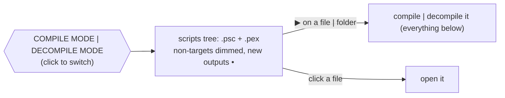

# Papyrus

Tooling for the Papyrus scripting language of Skyrim, in Rust.


## Features

| Tool                             | What                                                                    |
| -------------------------------- | ----------------------------------------------------------------------- |
| **Language server**              | VS Code extension included, see below                                   |
| **Compiler**                     | `.psc` → `.pex` — same code and same arguments as `PapyrusCompiler.exe` |
| **Decompiler**                   | `.pex` → `.psc` — compiles back to the same code                        |
| **Linter**                       | clippy-like levels and groups, `--fix`                                  |
| **Formatter** · **Disassembler** | `fmt` · `disasm`                                                        |
| **Tests** · **Debugger**         | `; #[test]` functions run in a Papyrus VM, natives mocked · DAP         |

Language server:

|              |                                                                                                              |
| ------------ | ------------------------------------------------------------------------------------------------------------ |
| Diagnostics  | like the official compiler, with related places (`defined here`)                                             |
| Navigation   | hover (operators, may-be-None values) · definition · declaration (overridden function) · references · rename |
| Editing      | completion · signature help · snippets · inlay hints (parameters, `overrides Quest`)                         |
| Code actions | quick fixes (check None, allow a lint) · De Morgan · inline variable                                         |
| Display      | semantic tokens · folding · symbols · formatting · `▶ Run Test` \| `⚙ Debug` code lenses                     |

Imported scripts (game sources, `[build] imports`) are read only: never formatted, renamed or fixed. The fragments of the Creation Kit (`;BEGIN FRAGMENT CODE` to `;END FRAGMENT CODE`) are never formatted or changed by a code action or `lint --fix`.

## Quick start

```sh
papyrus_analyzer                                  # language server (stdio)
papyrus_analyzer compile                          # the project of papyrus.toml
papyrus_analyzer decompile -o out Scripts/        # whole folders, structure kept
papyrus_analyzer lint [--fix] [-D warnings] [PATH]...
papyrus_analyzer fmt [--check] [PATH]...
papyrus_analyzer disasm Foo.pex
papyrus_analyzer test [PATH | FILTER]...          # the ; #[test] functions, see Tests
papyrus_analyzer run MyQuest.Start 3 "text"       # a function in the VM
papyrus_analyzer help [COMMAND]                   # the options of a command (or COMMAND --help)
papyrus_compiler MyQuest -i=Source -o=Scripts -f=TESV_Papyrus_Flags.flg   # PapyrusCompiler.exe compatible
```

The [releases](https://github.com/SARDONYX-sard/papyrus_analyzer/releases) have `papyrus_analyzer` (zip on Windows, tar.gz on Linux and macOS) and the VS Code extension (`.vsix`).

VS Code (1.91+, also Cursor, Antigravity...): the **Papyrus** view of the activity bar shows `.psc` and `.pex` together and compiles | decompiles in one click. It shows up in workspaces with Papyrus only (a `papyrus.toml`, or `.psc` / `.pex` files once a script is open); `"papyrus.explorer.show": "always"` shows it everywhere. The extension starts with a `papyrus.toml` at the root or on opening a script: other repositories are not searched.



Test scripts (`[test] sources`) are never compiled: their button runs their tests instead.

With a `papyrus.toml`: `Papyrus: Format Project` · `Papyrus: Lint Project` · `Papyrus: Lint Project: Fix All` run `fmt` / `lint` / `lint --fix` on all its `[build]` and `[test] sources`, in a terminal.

Header rows: `Compiler:` built-in | `[compiler] path` · `Output:` the output directory of the mode (click → reveal). Title bar: _Compile Selected Scripts…_ (a quick pick), compile | decompile all, refresh, expand all.

## `papyrus.toml`

Optional. The two modes:

|             | with `papyrus.toml`               | without ("limited")                                  |
| ----------- | --------------------------------- | ---------------------------------------------------- |
| Sources     | `[build] sources`                 | the workspace folders                                |
| Imports     | `[build] imports`                 | the installed game scripts (`SKYRIM_DIR` → registry) |
| Compiler    | `[compiler] path` \| built-in     | built-in                                             |
| Output      | `[build] output` (+ `/decompile`) | `build/papyrus/{compile,decompile}`                  |
| Diagnostics | every source script               | open scripts only                                    |

Each workspace folder has its own mode, and each `papyrus.toml` its own projects. Scripts of a folder with `papyrus.toml`, outside of `[build] sources` and `[test] sources`, are not of the project: known only while open, with the default settings.

```toml
"$schema" = "https://raw.githubusercontent.com/SARDONYX-sard/papyrus_analyzer/refs/tags/0.2.2/schemas/papyrus.schema.json"

[package]
name    = "MyMod"
version = "0.1.0"

[var]
SKYRIM_DIR = "${game:SkyrimSE}"

[build]
sources = ["."]
imports = ["${SKYRIM_DIR}/Data/Scripts/Source"]
flags   = "${SKYRIM_DIR}/Data/Scripts/Source/TESV_Papyrus_Flags.flg"
```

`$schema` documents and completes every setting in the editor: use [Tombi](https://github.com/tombi-toml/tombi) or [TOML Analyzer](https://github.com/Thoughts-with-friends/toml_analyzer). `Papyrus: Create papyrus.toml` writes a template, with the `$schema` of the version of the server.

### Variables

Machine paths are `${NAME}` variables. Lookup order, first wins:

`papyrus.var` setting | `--var NAME=VALUE` > `[var]` of `papyrus.local.toml` (not committed) > `[var]` of `papyrus.toml`

| Built-in             | Value                                                                                                    |
| -------------------- | -------------------------------------------------------------------------------------------------------- |
| `${env:NAME}`        | environment variable                                                                                     |
| `${workspaceFolder}` | the workspace folder                                                                                     |
| `${game:SkyrimSE}`   | game installation from the registry (Windows) — `SkyrimLE` \| `SkyrimVR` \| `Enderal` \| `EnderalSE` too |
| `~`                  | home directory (leading only)                                                                            |

### Workspaces

Several mods in one folder, like Cargo workspaces:

```text
my-mods/
├─ papyrus.toml          # [workspace]: members + shared settings
├─ MCMHelper/
│  ├─ papyrus.toml       # [package] name = "MCMHelper"
│  └─ Source/Scripts/MCM.psc
└─ Requiem/
   ├─ papyrus.toml       # [dependencies] MCMHelper = { path = "../MCMHelper" }
   └─ Source/Scripts/REQ_MCM_DataStorage.psc
```

```toml
# my-mods/papyrus.toml
[workspace]
members = ["*"]

[workspace.var]
SKYRIM_DIR = "${game:SkyrimSE}"

[workspace.build]
imports = ["${SKYRIM_DIR}/Data/Scripts/Source"]

[workspace.lints]
style = "allow"
```

```toml
# my-mods/Requiem/papyrus.toml
[var]
SKYRIM_DIR.workspace = true

[build]
imports.workspace = true

[lints]
workspace = true
```

Like in `Cargo.toml`, nothing applies by itself: a member asks for what it wants.

| Workspace table                            | Member                                                 |
| ------------------------------------------ | ------------------------------------------------------ |
| `[workspace.var]` · `compiler` · `build`   | `key.workspace = true`, for each value                 |
| `[workspace.lints]` · `[workspace.format]` | `workspace = true`, alone in the table                 |
| `members` · `exclude`                      | may use `[var]` and `[workspace.var]` of the same file |

- A member sees its sources + `[dependencies]` (transitively) + imports, nothing else — like the compiler:
  - `MCM` in Requiem → `MCMHelper/…/MCM.psc` ✓
  - sibling member, not a dependency → invisible (no false `name-is-type`) ✗
- Opening a member folder → loads the whole workspace.
- Each member → its own `output`, lints and format.

## Lints

| Level   | Meaning |
| ------- | ------- |
| `allow` | off     |
| `warn`  | warning |
| `deny`  | error   |

| Group                                 | Default |
| ------------------------------------- | ------- |
| `correctness`                         | `deny`  |
| `suspicious` · `complexity` · `style` | `warn`  |
| `pedantic`                            | `allow` |

Precedence: lint name > group > `all` · command line > `papyrus.toml`

```sh
papyrus_analyzer lint --list
papyrus_analyzer lint -D warnings -A style --fix Scripts/Source
```

Fixes that change what the code does need `--allow-manual-fixes`. With `--check-vcs`, `--fix` works like `cargo fix`: it refuses scripts with uncommitted changes and to run outside of a git repository, unless `--allow-dirty` · `--allow-staged` · `--allow-no-vcs` let it.

### Attributes

Rust-like attributes, in comments:

| Attribute                    | Applies to                                                                            |
| ---------------------------- | ------------------------------------------------------------------------------------- |
| `; #[allow(names)]`          | the next declaration \| statement (a whole `Function`, `If`...), on the line above it |
| `; #![allow(names)]`         | the whole file — before the code, at the top                                          |
| `; #[fmt::skip]`             | same as `#[allow]` — kept as written                                                  |
| `; #![fmt::skip]`            | the whole file, not formatted — before the code, at the top                           |
| `; #[test]`                  | the next function: a test, see [Tests](#tests)                                        |
| `; #[mock(Script.Function)]` | the next function: replaces the native in the tests of its script                     |

Attributes have completion, hover and go to definition (the mocked native); unknown ones are reported. Like in Rust, they go before what they apply to: after code on its line, or `#![...]` below the code, an attribute applies to nothing (`misplaced-attribute`, with a quick fix moving it).

`names`: lints (`unused_local` | `unused-local`) · groups · `all`; none → every lint. Text after `]` (a reason) is ignored. Attributes stack, one per line: a long list can be split (`[format] max-width` does it).
Quick fixes on a lint problem add them: _Allow `code` here_ · _Allow `code` in this file_.

```papyrus
; #[allow(unused_local)]           ; the whole function
Function F()
    Int unused = 1
    ; #[fmt::skip]                 ; aligned by hand
    Float[] m = new Float[9]
EndFunction
```

## Tests

Unit tests of scripts, outside of the game: a VM runs the compiled code. A test script extends the script it tests, in `[test] sources`:

```papyrus
ScriptName MyQuestTests extends MyQuest
Import PapyrusAnalyzer             ; built in, seen by the test sources only

; #[test]
Function CountsKills()
    RecordKill()
    AssertIntEq(Kills, 1, "one kill")
EndFunction

; #[mock(Game.GetPlayer)] the object it is called on comes first when declared
Actor Function FakePlayer()
    Return None
EndFunction
```

- Each test runs on a new object, after its `OnInit`. It fails on a failed assertion, an error the game would log (a call on `None`, an index out of range...) or `Return False`.
- `PapyrusAnalyzer`: `AssertIntEq` · `AssertFloatEq` · `AssertStringEq` · `AssertBoolEq` · `AssertTrue` · `AssertFalse` · `AssertNone` · `AssertNotNone` · `Fail`. A project script of the same name wins.
- Natives: `Debug.Trace` prints, `Math` · `StringUtil` · `Utility.Random*` (seeded) work, the others return their default value and are listed. `#[mock]` replaces one; its signature is checked.
- Events: `Utility.Wait` advances the clock and sends the `OnUpdate` (`RegisterForUpdate`...) that are due; other events are called like functions.
- Objects as strings read like in the game: `"" + Self` → `[MyQuestTests < (FF000000)>]`, `None` → `None`.

```sh
papyrus_analyzer test                      # every test
papyrus_analyzer test tests/MyQuestTests.psc   # the tests of a file | folder
papyrus_analyzer test kills                # the tests whose Script.Function contains it
```

The report reads like `cargo test`: a line per test, the output (`Debug.Trace`) and the errors of the failures, then `test result: ok. 3 passed; 0 failed; 0 filtered out; finished in 1.38s` (`ok`/`FAILED` in color on a terminal, unless `NO_COLOR` is set). `papyrus_analyzer run Script.Function` (▶︎ Run Test) prints one test the same way, with its native calls.

VS Code: `▶︎ Run Test` | `⚙︎ Debug` above each test. The debugger (`papyrus_analyzer debug`, launch type `papyrus`) has breakpoints, steps, the call stack, the variables (locals, `Self`) and watch expressions: Papyrus expressions without calls, like `values[i] * 2` or `Self.Count > 3`.

## Contributing

See [docs/developer.md](docs/developer.md): architecture, adding lints and assists, tests, building the extension.

## Thanks

- [rust-analyzer](https://github.com/rust-lang/rust-analyzer) — design studied closely
- [russo-2025/papyrus-compiler](https://github.com/russo-2025/papyrus-compiler)
- [matklad's resilient LL parsing](https://matklad.github.io/2023/05/21/resilient-ll-parsing-tutorial.html)

## License

This code was created by studying rust-analyzer; as a whole it can be considered a product of it.

```txt
SPDX-FileCopyrightText: (C) 2026 rust-analyzer team
SPDX-License-Identifier: Apache-2.0 OR MIT
```
