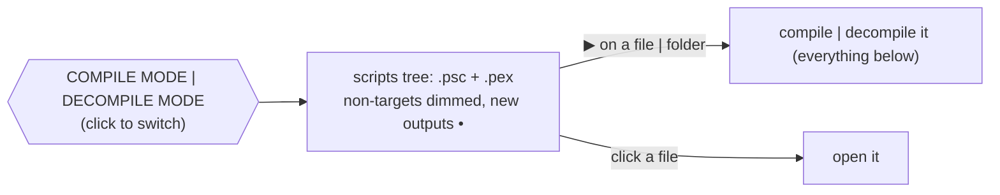

# Papyrus

Tooling for the Papyrus scripting language of Skyrim, in Rust.


## Features

| Tool                             | What                                                                    |
| -------------------------------- | ----------------------------------------------------------------------- |
| **Language server**              | VS Code extension included, see below                                   |
| **Compiler**                     | `.psc` → `.pex` — same code and same arguments as `PapyrusCompiler.exe` |
| **Decompiler**                   | `.pex` → `.psc` — compiles back to the same code                        |
| **Linter**                       | clippy-like levels and groups, `--fix`                                  |
| **Formatter** · **Disassembler** | `fmt` · `disasm`                                                        |
| **Tests** · **Debugger**         | `; #[test]` functions run in a Papyrus VM, natives mocked · DAP         |

Language server:

|              |                                                                                                              |
| ------------ | ------------------------------------------------------------------------------------------------------------ |
| Diagnostics  | like the official compiler, with related places (`defined here`)                                             |
| Navigation   | hover (operators, may-be-None values) · definition · declaration (overridden function) · references · rename |
| Editing      | completion · signature help · snippets · inlay hints (parameters, `overrides Quest`)                         |
| Code actions | quick fixes (check None, allow a lint) · De Morgan · inline variable                                         |
| Display      | semantic tokens · folding · symbols · formatting · `▶ Run Test` \| `⚙ Debug` code lenses                     |

Never changed: imported scripts · Creation Kit fragments (`;BEGIN FRAGMENT CODE` … `;END FRAGMENT CODE`).

## Quick start

```sh
papyrus_analyzer                                  # language server (stdio)
papyrus_analyzer compile                          # the project of papyrus.toml
papyrus_analyzer decompile -o out Scripts/        # whole folders, structure kept
papyrus_analyzer lint [--fix] [-D warnings] [PATH]...
papyrus_analyzer fmt [--check] [PATH]...
papyrus_analyzer disasm Foo.pex
papyrus_analyzer test [PATH | FILTER]...          # the ; #[test] functions, see Tests
papyrus_analyzer run MyQuest.Start 3 "text"       # a function in the VM
papyrus_analyzer help [COMMAND]                   # the options of a command (or COMMAND --help)
papyrus_compiler MyQuest -i=Source -o=Scripts -f=TESV_Papyrus_Flags.flg   # PapyrusCompiler.exe compatible
```

Download: [releases](https://github.com/SARDONYX-sard/papyrus_analyzer/releases) — `papyrus_analyzer` · VS Code extension (`.vsix`).

## VS Code

1.91+, also Cursor, Antigravity...

**Papyrus** view: `.psc` and `.pex` together, compile | decompile in one click.



| Command                          | Runs                  |
| -------------------------------- | --------------------- |
| `Papyrus: Format Project`        | `fmt` on the sources  |
| `Papyrus: Lint Project`          | `lint` on the sources |
| `Papyrus: Lint Project: Fix All` | `lint --fix`          |

- Test scripts: ▶ runs their tests. Scripts with ` ```papyrus ` examples: 📖 runs their doc tests (folders: right click).
- Starts on: a `papyrus.toml` at the root · opening a script.
- `"papyrus.explorer.show": "always"`: the view in every workspace.

## `papyrus.toml`

Optional.

|             | with `papyrus.toml`               | without ("limited")                                  |
| ----------- | --------------------------------- | ---------------------------------------------------- |
| Sources     | `[build] sources`                 | the workspace folders                                |
| Imports     | `[build] imports`                 | the installed game scripts (`SKYRIM_DIR` → registry) |
| Compiler    | `[compiler] path` \| built-in     | built-in                                             |
| Output      | `[build] output` (+ `/decompile`) | `build/papyrus/{compile,decompile}`                  |
| Diagnostics | every source script               | open scripts only                                    |

Per script, per workspace folder:

| Script                              | Sees                 | Settings       |
| ----------------------------------- | -------------------- | -------------- |
| in `[build]` \| `[test] sources`    | its project only     | `papyrus.toml` |
| anywhere else, or no `papyrus.toml` | every script (loose) | defaults       |

```toml
"$schema" = "https://raw.githubusercontent.com/SARDONYX-sard/papyrus_analyzer/refs/tags/0.2.2/schemas/papyrus.schema.json"

[package]
name    = "MyMod"
version = "0.1.0"

[var]
SKYRIM_DIR = "${game:SkyrimSE}"

[build]
sources = ["."]
imports = ["${SKYRIM_DIR}/Data/Scripts/Source"]
flags   = "${SKYRIM_DIR}/Data/Scripts/Source/TESV_Papyrus_Flags.flg"

[lints]
complexity   = "warn"
unused-local = "deny"
pedantic     = "allow"

[format]
indent-style  = "space"
indent-size   = 4
newline       = "lf"
final-newline = true
keyword-case  = "canonical"
```

- Every setting: `$schema`, with [Tombi](https://github.com/tombi-toml/tombi) or [TOML Analyzer](https://github.com/Thoughts-with-friends/toml_analyzer).
- Template: `Papyrus: Create papyrus.toml`.

### Warning: Identifier casing

The following settings are also available under `[format]`, but require some caution:

```toml
[format]
script-case = "canonical"
function-case = "canonical"
property-case = "canonical"
variable-case = "canonical"
flag-case = "canonical"
```

Papyrus is case-insensitive, but Creation Kit may be case-sensitive in some contexts. Inconsistent casing between script declarations and references (e.g. property types) may break existing Creation Kit bindings, such as UI bindings. The exact behavior is undocumented.

For this reason, `script-case` and `property-case` accept only `canonical` (the spelling of the `ScriptName` or the property declaration) and `preserve`. `canonical` follows the `ScriptName` line, not the file name: keep both spelled alike, e.g. `ScriptName MEP_CageManager` in `MEP_CageManager.psc`.

### Variables

`${NAME}`, first wins:

`papyrus.var` setting | `--var NAME=VALUE` > `papyrus.local.toml` (not committed) > `papyrus.toml`

| Built-in             | Value                                                                                                    |
| -------------------- | -------------------------------------------------------------------------------------------------------- |
| `${env:NAME}`        | environment variable                                                                                     |
| `${workspaceFolder}` | the workspace folder                                                                                     |
| `${game:SkyrimSE}`   | game installation from the registry (Windows) — `SkyrimLE` \| `SkyrimVR` \| `Enderal` \| `EnderalSE` too |
| `~`                  | home directory (leading only)                                                                            |

### Workspaces

Like Cargo workspaces:

```text
my-mods/
├─ papyrus.toml          # [workspace]: members + shared settings
├─ MCMHelper/
│  ├─ papyrus.toml       # [package] name = "MCMHelper"
│  └─ Source/Scripts/MCM.psc
└─ Requiem/
   ├─ papyrus.toml       # [dependencies] MCMHelper = { path = "../MCMHelper" }
   └─ Source/Scripts/REQ_MCM_DataStorage.psc
```

```toml
# my-mods/papyrus.toml
[workspace]
members = ["*"]

[workspace.var]
SKYRIM_DIR = "${game:SkyrimSE}"

[workspace.build]
imports = ["${SKYRIM_DIR}/Data/Scripts/Source"]

[workspace.lints]
style = "allow"
```

```toml
# my-mods/Requiem/papyrus.toml
[var]
SKYRIM_DIR.workspace = true

[build]
imports.workspace = true

[lints]
workspace = true
```

Nothing is inherited unless asked:

| Workspace table                            | Member                                                 |
| ------------------------------------------ | ------------------------------------------------------ |
| `[workspace.var]` · `compiler` · `build`   | `key.workspace = true`, for each value                 |
| `[workspace.lints]` · `[workspace.format]` | `workspace = true`, alone in the table                 |
| `members` · `exclude`                      | may use `[var]` and `[workspace.var]` of the same file |

A member sees: its sources + `[dependencies]` + its imports.

## Lints

| Level   | Meaning |
| ------- | ------- |
| `allow` | off     |
| `warn`  | warning |
| `deny`  | error   |

| Group                                 | Default |
| ------------------------------------- | ------- |
| `correctness`                         | `deny`  |
| `suspicious` · `complexity` · `style` | `warn`  |
| `pedantic`                            | `allow` |

Precedence: lint name > group > `all` · command line > `papyrus.toml`

```sh
papyrus_analyzer lint --list
papyrus_analyzer lint -D warnings -A style --fix Scripts/Source
```

| With `--fix`                                          |                                              |
| ----------------------------------------------------- | -------------------------------------------- |
| `--allow-manual-fixes`                                | also fixes that change what the code does    |
| `--check-vcs`                                         | refuse uncommitted changes, like `cargo fix` |
| `--allow-dirty` · `--allow-staged` · `--allow-no-vcs` | with `--check-vcs`: let them                 |

Leave scripts out: `exclude = ["src/vendor"]` in `[lints]` | `[format]`.

### Attributes

In comments, before what they apply to:

| Attribute                    | Applies to                                                                            |
| ---------------------------- | ------------------------------------------------------------------------------------- |
| `; #[allow(names)]`          | the next declaration \| statement (a whole `Function`, `If`...), on the line above it |
| `; #![allow(names)]`         | the whole file — before the code, at the top                                          |
| `; #[fmt::skip]`             | same as `#[allow]` — kept as written                                                  |
| `; #![fmt::skip]`            | the whole file, not formatted — before the code, at the top                           |
| `; #[test]`                  | the next function: a test, see [Tests](#tests)                                        |
| `; #[mock(Script.Function)]` | the next function: replaces the native in the tests of its script                     |

`names`: lints (`unused_local` | `unused-local`) · groups · `all`; none → every lint.

```papyrus
; #[allow(unused_local)]           ; the whole function
Function F()
    Int unused = 1
    ; #[fmt::skip]                 ; aligned by hand
    Float[] m = new Float[9]
EndFunction
```

## Tests

Run outside of the game, in a VM. A test script extends the script it tests, in `[test] sources`:

```papyrus
ScriptName MyQuestTests extends MyQuest
Import PapyrusAnalyzer             ; built in, seen by the test sources only

; #[test]
Function CountsKills()
    RecordKill()
    AssertIntEq(Kills, 1, "one kill")
EndFunction

; #[mock(Game.GetPlayer)] the object it is called on comes first when declared
Actor Function FakePlayer()
    Return None
EndFunction
```

|          |                                                                                                                                              |
| -------- | -------------------------------------------------------------------------------------------------------------------------------------------- |
| Fails on | failed assertion · error the game would log (call on `None`...) · `Return False`                                                             |
| Asserts  | `AssertIntEq` · `AssertFloatEq` · `AssertStringEq` · `AssertBoolEq` · `AssertTrue` · `AssertFalse` · `AssertNone` · `AssertNotNone` · `Fail` |
| Objects  | `NewObject("Actor") as Actor` · `NewAlias` · `NewEffect` · `Game.GetPlayer()`                                                                |
| Calls    | `AssertCalled("Actor.Disable", 1)` · `AssertNotCalled` · `AssertCalledOn` · `CallCount`                                                      |
| Natives  | work: `Debug.Trace` · `Math` · `StringUtil` · `Utility.Random*` — others: default value, or `#[mock]`                                        |
| Events   | `Utility.Wait` sends the `OnUpdate` due · `SendModEvent` calls back at once — others: call them                                              |

```sh
papyrus_analyzer test                      # every test
papyrus_analyzer test tests/MyQuestTests.psc   # the tests of a file | folder
papyrus_analyzer test kills                # the tests whose Script.Function contains it
papyrus_analyzer test --doc                # the doc tests only
```

Doc tests, like rustdoc: the ` ```papyrus ` examples of documentation comments and `.md` files compile and run.

| Fence                  |                                 |
| ---------------------- | ------------------------------- |
| ` ```papyrus `         | compiled and run                |
| ` ```papyrus,no_run `  | compiled only                   |
| ` ```papyrus,ignore `  | skipped                         |
| `# Int x = 1` (a line) | in the test, hidden from hovers |

````papyrus
; # Examples
;
; ```papyrus
; AssertIntEq(Add(1, 2), 3)
; ```
Int Function Add(Int a, Int b) Global
{Adds.}                            ; { } is in the .pex, shown in the Creation Kit: the summary only
````

VS Code: `▶︎ Run Test` | `⚙︎ Debug` above each test, `▶︎ Run Doctest` above each example — breakpoints · steps · call stack · variables · watch expressions (no calls).

## Contributing

See [docs/developer.md](docs/developer.md): architecture, adding lints and assists, tests, building the extension.

## Thanks

- [rust-analyzer](https://github.com/rust-lang/rust-analyzer) — design studied closely
- [russo-2025/papyrus-compiler](https://github.com/russo-2025/papyrus-compiler)
- [matklad's resilient LL parsing](https://matklad.github.io/2023/05/21/resilient-ll-parsing-tutorial.html)

## License

This code was created by studying rust-analyzer; as a whole it can be considered a product of it.

```txt
SPDX-FileCopyrightText: (C) 2026 rust-analyzer team
SPDX-License-Identifier: Apache-2.0 OR MIT
```
